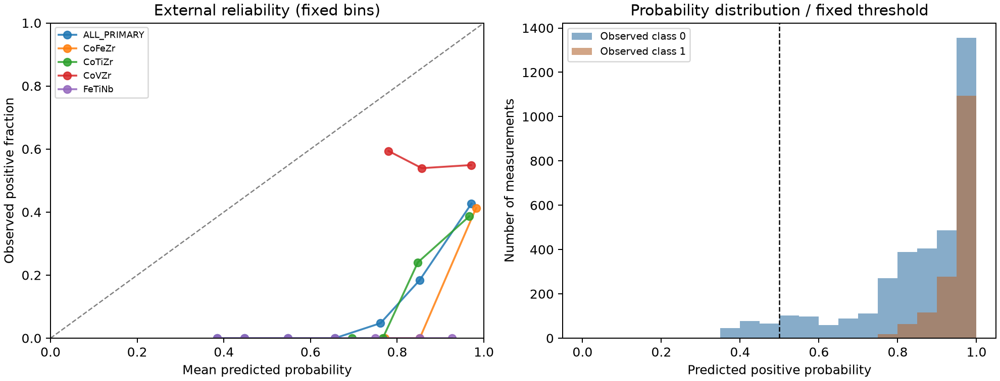
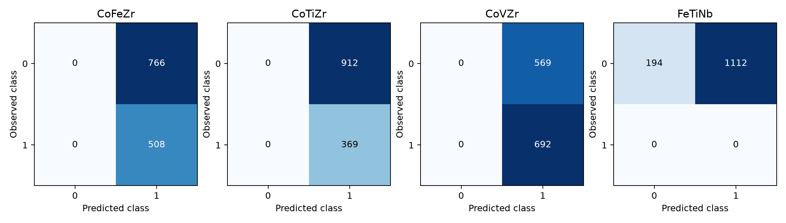

# 外部玻璃数据：为什么排序尚可，分类却失效

这是对已经评估过的外部数据的事后描述性分析，不是新的盲测。模型、预测、样本排除规则和阈值沿用原冻结实验；没有用外部标签训练、校准或挑选阈值。

## 核心发现

主集合 5,122 条，真实正类 30.63%，模型平均概率 88.67%，预测正类 96.21%。混淆矩阵为 TN=194、FP=3359、FN=0、TP=1569：高召回伴随大量假阳性。

源训练集正类占 71.04%，外部主集合占 30.63%，且制备条件发生变化。这些是可观察到的分布差异，不能据此证明某个因素单独导致失效。后续应核对标签语义、制备条件和特征覆盖。

## 分体系结果

| system | n | positive_fraction | mean_probability | predicted_positive_fraction | roc_auc | balanced_accuracy | brier |
| --- | --- | --- | --- | --- | --- | --- | --- |
| ALL_PRIMARY | 5122 | 0.30633 | 0.88670 | 0.96212 | 0.74601 | 0.52730 | 0.52474 |
| CoFeZr | 1274 | 0.39874 | 0.97683 | 1.00000 | 0.74405 | 0.50000 | 0.56303 |
| CoTiZr | 1281 | 0.28806 | 0.90468 | 1.00000 | 0.69342 | 0.50000 | 0.56950 |
| CoVZr | 1261 | 0.54877 | 0.94831 | 1.00000 | 0.47379 | 0.50000 | 0.41389 |
| FeTiNb | 1306 | 0.00000 | 0.72167 | 0.85145 | — | — | 0.55051 |

CoFeZr、CoTiZr、CoVZr 三个含正负样本的体系都被全部判为正类，balanced accuracy 均为 0.5。CoVZr 的 AUC 点估计约 0.474，整体 AUC 不能代表每个体系；这里不据此宣称统计上显著劣于随机。FeTiNb 只有负类，AUC、average precision 和 balanced accuracy 均为未定义。

## 概率参照

| model | roc_auc | accuracy | brier |
| --- | --- | --- | --- |
| frozen_model | 0.74601 | 0.34420 | 0.52474 |
| source_prevalence | 0.50000 | 0.30633 | 0.37576 |
| constant_0.5 | 0.50000 | 0.69367 | 0.25000 |
| constant_0 | 0.50000 | 0.69367 | 0.30633 |

Brier 越低越好。原模型高于源训练集正类比例的恒定预测，也高于恒定 0.5 的 0.25。当前外部概率不可靠，不能因为 AUC 较高就解释为可靠的成功概率。恒定参照的多数类 accuracy 高也不代表有辨别能力，其 AUC 为 0.5。阈值沿用 prediction > 0.5，恰好 0.5 判为负类。

## 图表与距离分组

左图比较十个等宽概率箱中的平均预测与实际正类比例，样本数及空箱保存在 reliability_bins.csv。ECE 对分箱方式敏感，不作为跨总体保证。

组成 L1 距离分组见 distance_metrics.csv。距离、材料体系和制备条件可能共同变化，不把分组差异解释为单一因果效应。

## 后续验证边界

若开发校准或阈值策略，应在源训练数据内层拟合。当前外部集已被查看，后续改进属于探索性研究；独立迁移结论需要新的留出来源。现有失败结果保留，不用后续调参覆盖。
