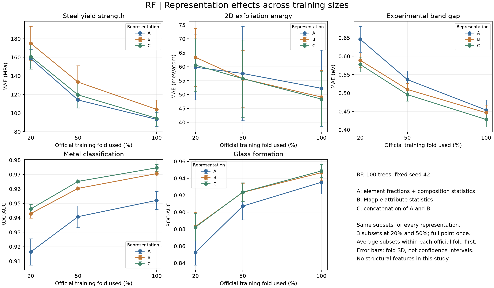
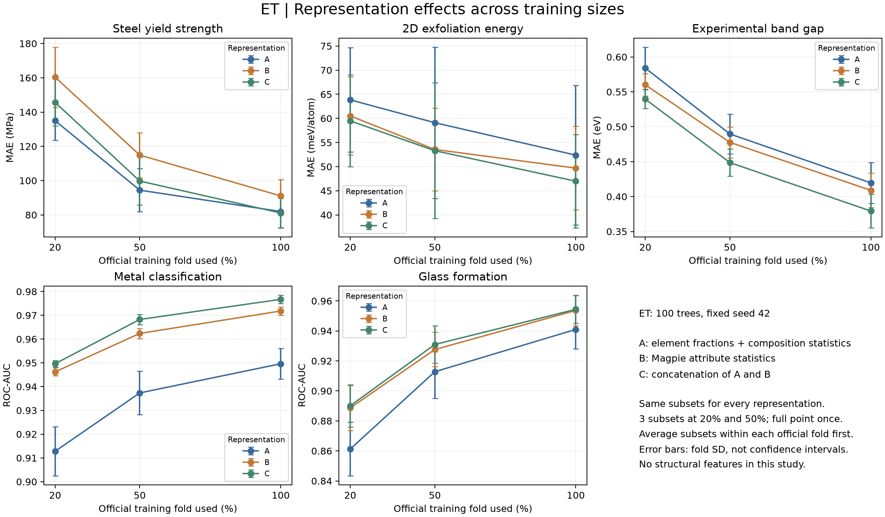

# 小数据 × 科学表示：配对对照实验

五个 Matbench 任务使用官方五折。固定 RF/ET 各 100 棵树，对比 A（元素比例、元素数、组成熵与比例平方和）、B（Magpie 属性统计）、C（A+B）。每个官方训练折取 20%、50%、100%；前两档各三次随机抽样。相同折、比例、抽样种子在所有模型和表示间共享样本 ID，20% 子集嵌套于 50%。全量点只拟合一次。

本轮为既有基准上的探索性补充，未调参、未用测试结果选择新的主方法，也未改变老师要求的官方全量五折主结果。这里仅研究组成表示，二维材料的结构表示另见原实验。

## 实测与审计

共完成 1,050 次拟合及 1,050 个保存模型重放。审计逐项检查官方测试 ID、训练子集、目标、预测、模型预算以及训练内补缺和标准化。先平均每个官方折内的抽样重复，再统计五折均值和标准差。重复抽样并非独立测试集，折间标准差也不是置信区间。

## C 相对 A 的收益

下表统一规定正值代表 C 较好：回归为 MAE(A) − MAE(C)，分类为 AUC(C) − AUC(A)。量纲按任务分别解释，不能把不同任务的数值直接求平均。`improved_folds` 是五折中 C 较好的折数，是描述性证据，不是显著性检验。

| task | model | fraction | mean_improvement | fold_sd | improved_folds |
| --- | --- | --- | --- | --- | --- |
| matbench_expt_gap | ET | 0.20000 | 0.04449 | 0.01710 | 5 |
| matbench_expt_gap | ET | 0.50000 | 0.04101 | 0.01799 | 5 |
| matbench_expt_gap | ET | 1.00000 | 0.04031 | 0.01933 | 5 |
| matbench_expt_gap | RF | 0.20000 | 0.06850 | 0.02047 | 5 |
| matbench_expt_gap | RF | 0.50000 | 0.04078 | 0.00715 | 5 |
| matbench_expt_gap | RF | 1.00000 | 0.02562 | 0.01147 | 5 |
| matbench_expt_is_metal | ET | 0.20000 | 0.03684 | 0.01063 | 5 |
| matbench_expt_is_metal | ET | 0.50000 | 0.03092 | 0.01092 | 5 |
| matbench_expt_is_metal | ET | 1.00000 | 0.02710 | 0.00749 | 5 |
| matbench_expt_is_metal | RF | 0.20000 | 0.02976 | 0.01082 | 5 |
| matbench_expt_is_metal | RF | 0.50000 | 0.02441 | 0.00803 | 5 |
| matbench_expt_is_metal | RF | 1.00000 | 0.02256 | 0.00680 | 5 |
| matbench_glass | ET | 0.20000 | 0.02882 | 0.00464 | 5 |
| matbench_glass | ET | 0.50000 | 0.01817 | 0.00704 | 5 |
| matbench_glass | ET | 1.00000 | 0.01338 | 0.00567 | 5 |
| matbench_glass | RF | 0.20000 | 0.02996 | 0.00370 | 5 |
| matbench_glass | RF | 0.50000 | 0.01647 | 0.00769 | 5 |
| matbench_glass | RF | 1.00000 | 0.01335 | 0.01103 | 4 |
| matbench_jdft2d | ET | 0.20000 | 4.36408 | 1.74917 | 5 |
| matbench_jdft2d | ET | 0.50000 | 5.80151 | 4.32584 | 5 |
| matbench_jdft2d | ET | 1.00000 | 5.39635 | 5.22749 | 5 |
| matbench_jdft2d | RF | 0.20000 | -0.76284 | 4.01186 | 3 |
| matbench_jdft2d | RF | 0.50000 | 1.84636 | 4.00079 | 3 |
| matbench_jdft2d | RF | 1.00000 | 3.86228 | 4.18400 | 4 |
| matbench_steels | ET | 0.20000 | -10.69423 | 9.91431 | 0 |
| matbench_steels | ET | 0.50000 | -5.32362 | 5.96478 | 1 |
| matbench_steels | ET | 1.00000 | 0.86811 | 3.95124 | 3 |
| matbench_steels | RF | 0.20000 | -2.08899 | 5.86791 | 2 |
| matbench_steels | RF | 0.50000 | -5.49243 | 8.72311 | 2 |
| matbench_steels | RF | 1.00000 | -1.17060 | 4.93800 | 2 |

## 小样本是否更受益

下表末列为“20% 时的 C−A 收益减去 100% 时的收益”。正值说明本次配对实验中 C 的优势在小样本档更大；负值说明优势更小或退步更明显。该交互量不证明科学描述符普遍能解决小数据问题。

| task | model | 0.2 | 1.0 | low_data_gain_minus_full |
| --- | --- | --- | --- | --- |
| matbench_expt_gap | ET | 0.04449 | 0.04031 | 0.00418 |
| matbench_expt_gap | RF | 0.06850 | 0.02562 | 0.04289 |
| matbench_expt_is_metal | ET | 0.03684 | 0.02710 | 0.00974 |
| matbench_expt_is_metal | RF | 0.02976 | 0.02256 | 0.00720 |
| matbench_glass | ET | 0.02882 | 0.01338 | 0.01545 |
| matbench_glass | RF | 0.02996 | 0.01335 | 0.01662 |
| matbench_jdft2d | ET | 4.36408 | 5.39635 | -1.03226 |
| matbench_jdft2d | RF | -0.76284 | 3.86228 | -4.62512 |
| matbench_steels | ET | -10.69423 | 0.86811 | -11.56234 |
| matbench_steels | RF | -2.08899 | -1.17060 | -0.91839 |

## 学习曲线

完整 B−A、C−B 对照见 paired_comparisons.csv；每次抽样指标见 fold_metrics.csv。随机训练子集不是按材料体系留出的新域测试；已有组成重复和跨域局限仍需保留。
